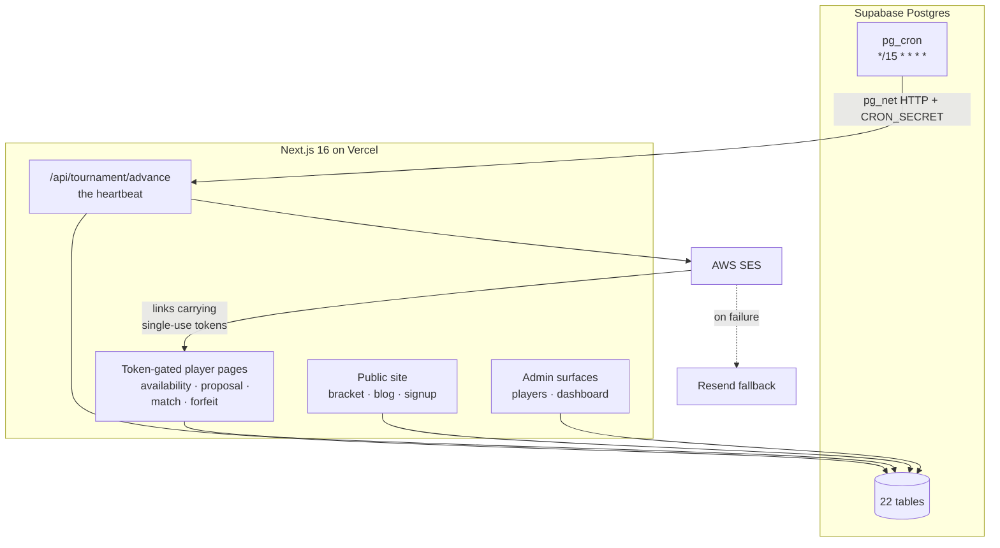
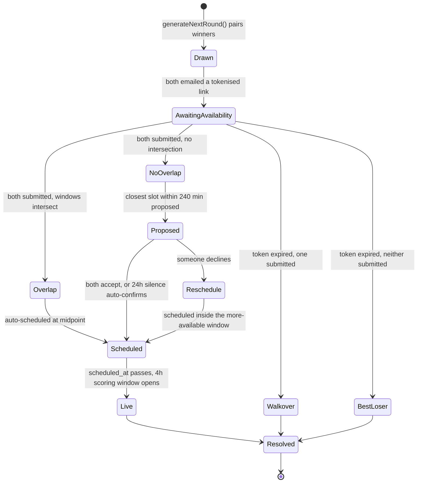
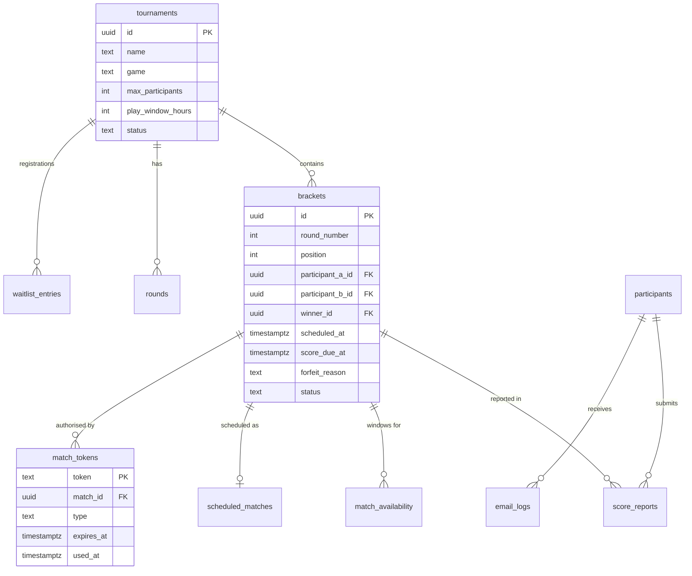

# Architecture

How Couch Cup runs a knockout tournament without a human in the loop.

- [System overview](#system-overview)
- [The heartbeat](#the-heartbeat)
- [Scheduling a match](#scheduling-a-match)
- [Resolving a result](#resolving-a-result)
- [Bracket construction](#bracket-construction)
- [Email and tokens](#email-and-tokens)
- [Data model](#data-model)
- [Design decisions](#design-decisions)
- [Known limitations](#known-limitations)

---

## System overview

The scheduler lives **inside the database**, not in the application. `pg_cron` fires every 15 minutes and uses `pg_net` to make an authenticated HTTP call back into `/api/tournament/advance`. Vercel's own cron feature is unused — `vercel.json` has an empty `crons` array.

That inversion is deliberate: the tournament's forward motion is a property of the data, so it belongs next to the data. It also means the schedule survives a redeploy, and that a single Postgres row can pause the entire tournament.

### Two paths to the database

An oddity worth knowing before reading the code. Most routes do **not** use `supabase-js`. They go through a `sql()` helper in `lib/supabase.ts` that posts raw SQL to the Supabase **Management API** using `SUPABASE_MANAGEMENT_TOKEN`.

A smaller set — the sponsors page, analytics routes, and screenshot upload — use `supabase-js` with the secret API key in the normal way.

The practical consequence: `SUPABASE_MANAGEMENT_TOKEN` is a single point of failure for almost every query, and because routes catch errors and return empty rather than throwing, a bad token doesn't produce an error page. The bracket simply renders as though the tournament has no rounds. A trailing newline in the environment value once caused exactly this, and it took a while to find because nothing anywhere reported a failure.

---

## The heartbeat

`lib/tournament-advance.ts`, reached via `GET /api/tournament/advance` with a bearer `CRON_SECRET`.

Every run takes a lock first. The `cron_lock` table holds one row; the endpoint claims it with an atomic conditional update and releases it at the end. The lock self-expires after 10 minutes so a crashed run can't deadlock the tournament permanently.

Then it walks eight checks in order. Each one asks "what has expired, and what should happen as a result?"

| # | Check | Trigger | Action |
|---|---|---|---|
| 1 | `checkUnscheduledAvailability` | both players submitted windows, no match scheduled | find overlap → schedule; none → propose a time; already declined → schedule in the more-available window |
| 2 | `checkUpcomingMatchReminders` | 24h and 2h before kickoff | match-day notice; 2h reminder + random assignment of who sends the game invite |
| 3 | `checkScoreWindowOpen` | `scheduled_at` has passed | open the 4-hour reporting window |
| 4 | `checkScoreReminders` | 2h into the window, nothing reported | nudge both players |
| 5 | `checkExpiredSchedulingWindows` | scheduling token expired, still unscheduled | one submitted → they advance; neither → promote best loser; nobody eligible → flag admin |
| 6 | `checkExpiredScoreWindows` | `score_due_at` passed, no winner | one report → accept it; none → promote best loser; contradictory → flag admin |
| 7 | `checkExpiredProposals` | proposed time neither accepted nor declined in 24h | auto-confirm the proposal |
| 8 | `checkExpiredSelections` | bracket invitation never accepted | reclaim the slot, promote from waitlist |

Every branch terminates in a state change. There is no path that leaves a match waiting indefinitely for a player who has stopped responding — which is the entire design goal, because in a free tournament a meaningful fraction of entrants simply go quiet.

### Best-loser promotion

The fallback that makes the rest safe. When a slot would otherwise be empty — both players missed a deadline — the system promotes the strongest losing player from the previous round rather than awarding a walkover into an empty bracket position.

Ranking is by `loss_margin` ascending, then `total_goals` descending: the player who lost by least, breaking ties on goals scored. Someone knocked out 3–2 in a high-scoring game re-enters ahead of someone beaten 5–0.

---

## Scheduling a match

The part with the most moving pieces. Two people who have never met must agree a time, by email, with no accounts.

**Submitting availability** — `app/availability/[token]`. Players give date + time ranges, stored one row per window in `match_availability`. The token expires in 12–24 hours depending on season.

**Finding an overlap** — `findOverlap()` looks for a shared date with intersecting times and picks the midpoint. From the Round of 16 onward, matches are staggered 30 minutes apart so they can be streamed sequentially rather than clashing.

**When there is no overlap** — `suggestTime()` finds the 30-minute slot closest to both players' stated windows, provided the gap is no more than 240 minutes. Beyond that the players are genuinely incompatible and it goes to a resubmission round. The proposal is emailed with accept and decline links; silence for 24 hours counts as acceptance, on the reasoning that a non-responding player shouldn't be able to block a match indefinitely.

**Match day** — the player-facing page shows the opponent's gaming ID, never their real name, and all times in SAST. Matches must be streamed to YouTube: no stream means no verifiable result, which means no advancement.

---

## Resolving a result

Both players report independently at `app/match/[token]` within four hours of kickoff. Reports land in `score_reports`, and the outcome depends on what the pair of reports looks like:

| Reports received | Outcome |
|---|---|
| Both agree on a winner | Winner recorded, loser eliminated, round-completion check fires |
| Both report the same draw | `triggerRematch()` — clear reports, reissue tokens, reset the 4h window |
| One reports a draw, one a win | Contradiction → `admin_reviews` |
| Both claim victory | Contradiction → `admin_reviews` |
| Only one report by deadline | That report stands — the silent player forfeits |
| No reports by deadline | Best-loser promotion, or admin flag if nobody is eligible |

When a result lands, `checkRoundCompletion()` counts unresolved matches in the round. At zero it calls `generateNextRound()`, which pairs the winners, creates the next round's `brackets` rows, and names the round (Final, Semi-finals, Quarter-finals, Round of 16, or Round N).

Note that `generateNextRound()` deliberately does **not** send the opponent-announcement emails. Those are held and released separately, so the bracket can be generated and inspected before players are told anything — which matters when a round has just resolved through several walkovers and you want to eyeball it first.

---

## Bracket construction

`lib/bracket.ts`, served from `/api/tournament/bracket` with 60-second caching.

Two different modes, because early and late rounds have different needs:

- **Round of 16 and later** — built from real `brackets` rows. Every match is a genuine record with participants, scores, status, and stream URL.
- **Earlier rounds** — projected upward from the last completed round's winners, with unresolved slots shown as TBD. With 64 entrants, materialising every early-round pairing produces a wall of empty fixtures nobody reads.

**Byes** are allocated when a round has an odd number of players: the last player advances automatically, tagged `forfeit_reason: 'Bye — odd number of players, auto-advanced'`, and receives a "you're through" email like any other advancement.

---

## Email and tokens

33 transactional templates in `lib/email.ts`, delivered through AWS SES with an automatic fallback to Resend when SES fails.

They cluster into: registration and paid entry; bracket selection; scheduling (availability, reminders, opponent announcement, confirmation); match day (24h notice, 2h reminder, invite-sender assignment); scoring (window open, confirmation, reminder); outcomes (advanced, in the final, champion, runner-up, eliminated, promoted); and conflict handling (no-overlap proposal, resubmit, forfeit warning, rematch, admin flag).

### Tokens instead of accounts

There is no login. Every action a player takes arrives as a link in an email carrying a 32-byte cryptographically random token.

Tokens live in `match_tokens` (per match) or `player_tokens` (per tournament), each with a `type` — scheduling, submission, proposal_accept, forfeit_accept — an `expires_at`, and a `used_at` stamped on first use. Single-use and time-bound.

The reasoning: a casual free tournament cannot afford a signup funnel with a password step. Every account you ask someone to create is entrants lost. The tradeoff is that anyone holding the link can act, so tokens are scoped as narrowly as possible — one token authorises one action on one match, and expires.

Every send is logged to `email_logs` with recipient, type, subject, and rendered body. Logging is best-effort and non-blocking: a logging failure never prevents an email going out.

---

## Data model

22 tables in total. The others cover blog content, sponsors, analytics snapshots, paid entry leads, admin reviews, and the `cron_lock` row.

RLS is enabled on all 22. Note that the secret key bypasses it, so for the server-side paths that key — not RLS — is the real security boundary.

`max_participants` is worth calling out because it reads misleadingly: it drives bracket-size mathematics and display only. It is **not** a registration cap, and changing it does not notify anyone.

---

## Design decisions

**The scheduler lives in Postgres.** Forward motion is a property of the tournament data, so it sits with the data. Survives redeploys; one row pauses everything.

**Deadlines always resolve.** Every waiting state has an expiry and a defined outcome. In a free tournament people go quiet, and a bracket that stalls on a non-responder is a dead tournament.

**Best-loser promotion over empty slots.** Keeps the bracket full and rewards the strongest eliminated player, rather than handing someone a free pass into an empty fixture.

**Tokens, not accounts.** No passwords, no login, no signup funnel beyond one form. Scope each token to one action and expire it.

**Silence counts as acceptance on proposals.** After 24 hours an unanswered proposal auto-confirms. A player who stops replying shouldn't be able to veto a match.

**Emails are held back from bracket generation.** Generating a round and announcing it are separate steps, so a round that resolved oddly can be reviewed before players hear about it.

**Contradictions escalate rather than resolve.** Two players both claiming victory is a human problem. The system flags it and stops.

---

## Known limitations

- **`participants` and `players` coexist.** Season 1 used the former; Season 2 introduced the latter plus `waitlist_entries`. Some paths still read the old table. The `psn_id` → `gaming_id` rename is likewise partial. Migrating mid-season risks breaking a live tournament, so it waits for a gap between seasons.
- **`release-round-alerts.ts` has a zero-width-window bug** at the round-release path, still open.
- **No automated tests.** Solo project; the tournament engine is verified by simulation scripts in `site3/scripts/` (`sim-scheduling.mjs`, `test-opponent-flow.mjs`) rather than a test suite. Given how much branching logic sits in the deadline handling, this is the gap I'd close first.
- **The `sql()` helper returns empty on error.** Good for uptime — the site never 500s — but it converts configuration mistakes into silent, hard-to-diagnose blankness.
- **Bracket projection is display-only** for early rounds, so pre-R16 matches have no durable record until they resolve.
